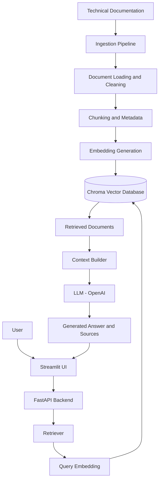
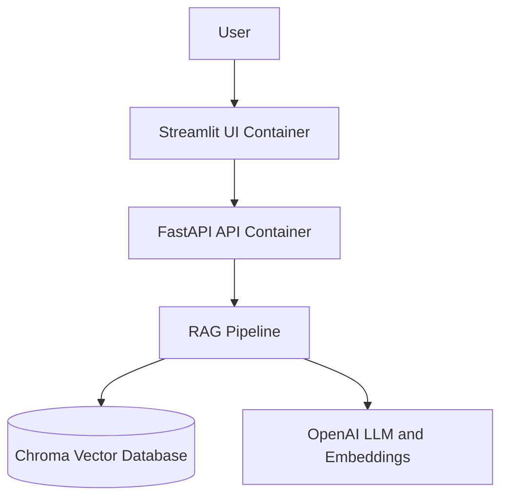
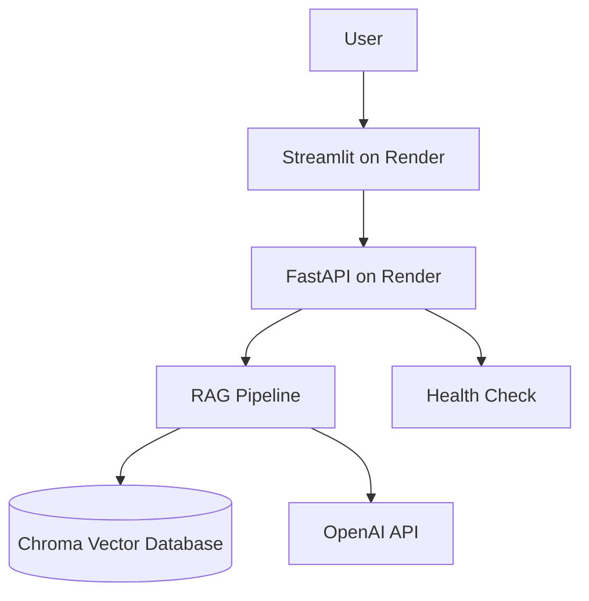
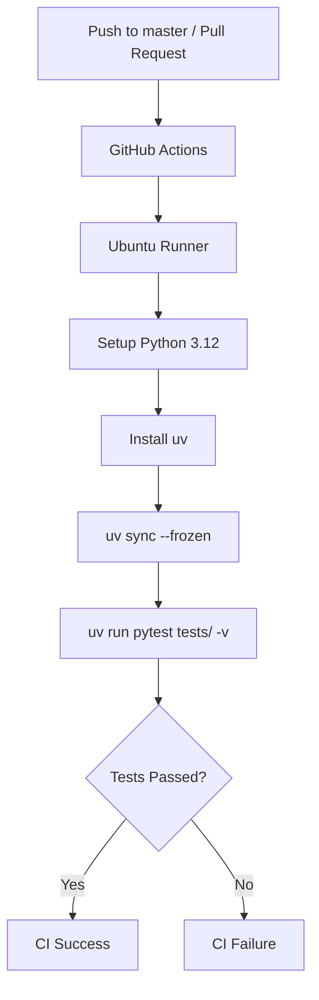

# Technical Documentation RAG Evaluation Harness

An evaluation-driven Retrieval-Augmented Generation (RAG) application built to answer questions from technical documentation using retrieval, grounded generation, source attribution, and systematic evaluation.

This project implements an end-to-end RAG pipeline over technical documentation covering Python, FastAPI, and LangChain. It combines document ingestion, chunking, embedding generation, vector-based retrieval, context construction, and LLM-based answer generation.

Beyond building a functional RAG application, this project focuses on evaluating and analyzing RAG performance through experiments involving retrieval strategies, chunking configurations, embedding models, query rewriting, reranking, and answer quality assessment.

The application is deployed with a FastAPI backend and Streamlit frontend, containerized using Docker, and supported by automated testing, CI, and LangSmith observability.

## Key Features

- **Document Ingestion:** Loads and processes technical documentation from multiple sources.
- **Document Chunking:** Splits documents into manageable chunks while preserving metadata.
- **Embedding Generation:** Generates vector embeddings using OpenAI embedding models.
- **Vector Search:** Retrieves relevant document chunks using ChromaDB.
- **Context-Grounded Generation:** Generates answers using retrieved context.
- **Source Attribution:** Provides source references for generated answers.
- **Abstention Handling:** Handles questions when relevant information is not available in the knowledge base.
- **RAG Evaluation:** Evaluates retrieval and generation quality using DeepEval.
- **Retrieval Experiments:** Experiments with chunk sizes, embedding models, retrieval thresholds, Top-K, hybrid retrieval, query rewriting, and reranking.
- **API Backend:** Exposes the RAG pipeline through FastAPI.
- **Interactive UI:** Provides a chat interface using Streamlit.
- **Observability:** Integrates LangSmith for tracing and monitoring.
- **Containerization:** Packages the application using Docker and Docker Compose.
- **Automated Testing:** Includes tests using Pytest.
- **Continuous Integration:** Runs automated tests through GitHub Actions.

## Architecture

The application follows a modular RAG architecture that separates document ingestion, retrieval, context construction, answer generation, API services, and user interface components.

The architecture supports a pipeline in which technical documentation is processed and indexed, user queries are matched against the knowledge base, relevant context is retrieved, and grounded responses are generated and presented with source references.

## Architecture diagram



## Tech Stack

| Component | Technology |
|---|---|
| Programming Language | Python 3.12 |
| LLM | OpenAI GPT-4.1-mini |
| Embedding Model | OpenAI text-embedding-3-large |
| RAG Framework | LangChain |
| Vector Database | ChromaDB |
| Retrieval | Dense Vector Retrieval |
| Backend API | FastAPI |
| Frontend | Streamlit |
| Evaluation | DeepEval |
| Observability | LangSmith |
| Testing | Pytest |
| Containerization | Docker & Docker Compose |
| CI | GitHub Actions |
| Package & Dependency Management | uv |
| Deployment | Render |

## Dataset & Knowledge Base

The knowledge base consists of technical documentation covering three major areas:

- **Python**
- **FastAPI**
- **LangChain**

The project includes 30 Markdown documentation files organized into source-specific directories under `data/raw/`.

The documents serve as the knowledge base for ingestion, chunking, embedding generation, indexing, retrieval, and grounded answer generation.

### Knowledge Base Structure

```text
data/
└── raw/
    ├── fastapi/
    ├── langchain/
    └── python/
```

The document ingestion pipeline supports Markdown, text, and PDF files.

## RAG Pipeline

The application implements an end-to-end Retrieval-Augmented Generation pipeline.

### 1. Document Loading

Technical documentation is loaded from the project's knowledge base using document loaders. Source metadata is maintained to support traceability.

### 2. Document Cleaning

Loaded documents are cleaned to remove unnecessary characters and formatting inconsistencies before further processing.

### 3. Document Chunking

Documents are split into smaller chunks using `RecursiveCharacterTextSplitter`. Chunk size and overlap are configurable.

The current configuration uses:

- **Chunk size:** 400
- **Chunk overlap:** 80

### 4. Embedding Generation

Document chunks are converted into vector embeddings using OpenAI's `text-embedding-3-large` embedding model.

### 5. Vector Store

Embeddings are stored in ChromaDB, which supports similarity-based retrieval of relevant document chunks.

### 6. Query Processing & Retrieval

When a user submits a question, the retriever searches the vector database for relevant document chunks.

The current retrieval configuration uses:

- **Top-K:** 3
- **Retrieval distance threshold:** 1.15

Retrieved documents are filtered based on the configured retrieval threshold.

### 7. Context Construction

Relevant retrieved chunks are formatted into a context that includes source-related metadata and document content.

### 8. Prompt Construction

The question and retrieved context are incorporated into a prompt designed to encourage grounded responses and handling of questions outside the knowledge base.

### 9. Answer Generation

The constructed prompt is passed to the OpenAI GPT-4.1-mini model to generate the response.

### 10. Source Attribution

Retrieved source information is used to provide source references alongside the generated answer.

### 11. Out-of-Knowledge-Base Handling

When relevant documents are not retrieved within the configured retrieval threshold, the application follows its fallback handling rather than proceeding with unsupported context.

## Retrieval & RAG Experiments

During development, multiple experiments were conducted to investigate different configurations and techniques that can influence Retrieval-Augmented Generation performance.

| Experiment | Objective |
|---|---|
| Chunk Size Experiment | Investigate the impact of chunk size and overlap on retrieval and answer quality. |
| Embedding Model Experiment | Compare embedding model configurations for document retrieval. |
| Retrieval Threshold Experiment | Investigate how retrieval distance thresholds influence relevance filtering and answer generation. |
| Top-K Experiment | Evaluate the impact of the number of retrieved document chunks. |
| Hybrid Retrieval Experiment | Explore combining dense retrieval and lexical retrieval. |
| Query Rewriting Experiment | Investigate query rewriting to improve retrieval for user questions. |
| Reranking Experiment | Explore reranking retrieved candidates to improve relevance. |
| Unanswerable Question Evaluation | Evaluate the application's handling of questions outside the knowledge base. |

Detailed experiment notes and analysis are available in the `experiments/` directory.

## Evaluation Framework

The project includes a structured evaluation framework to assess the performance of the Retrieval-Augmented Generation (RAG) pipeline across retrieval quality, answer generation, grounding and handling of unanswerable questions.

### Golden Evaluation Dataset

A curated golden evaluation dataset was created to systematically evaluate the RAG system.

The dataset contains questions designed to assess the system's ability to retrieve relevant documentation, generate accurate answers and handle queries beyond the knowledge base.

### Evaluation Methodology

The evaluation framework uses a combination of retrieval-level metrics and LLM-based evaluation metrics to assess the overall performance of the RAG system.

The evaluation process focuses on two primary aspects:

- **Retrieval Evaluation:** Measures whether the retriever returns relevant document chunks for a given query.
- **Generation Evaluation:** Measures the quality, relevance, correctness and faithfulness of the generated answers based on the retrieved context.

The golden dataset contains reference questions and expected answers, which are used to compare the system's retrieval results and generated responses against the evaluation criteria.


### Retrieval Evaluation

Retrieval performance was evaluated using ranking-based metrics to measure the relevance of retrieved document chunks against the expected relevant sources in the golden evaluation dataset.

The following metrics were used:

| Metric | Purpose |
|---|---|
| Precision@K | Measures the proportion of retrieved chunks within the top K results that are relevant. |
| Recall@K | Measures the proportion of relevant chunks that were successfully retrieved within the top K results. |
| Hit Rate@K | Measures the proportion of queries for which at least one relevant chunk was retrieved within the top K results. |
| Mean Reciprocal Rank (MRR) | Evaluates how highly the first relevant chunk is ranked across queries. |

These metrics were used to assess retrieval effectiveness, analyze ranking performance and support retrieval configuration experiments, including distance threshold tuning.

The retrieval evaluation results helped guide decisions regarding retrieval parameters and the overall retrieval strategy.

### DeepEval Metrics

DeepEval was used to evaluate the quality of the RAG pipeline using LLM-based evaluation metrics.

The evaluation framework includes the following metrics:

| Metric | Purpose |
|---|---|
| Contextual Precision | Evaluates whether the retrieved context contains relevant information and whether relevant chunks are ranked appropriately. |
| Contextual Recall | Measures whether the retrieved context contains the information required to answer the question. |
| Faithfulness | Evaluates whether the generated answer is grounded in the retrieved context rather than unsupported information. |
| Answer Relevancy | Measures whether the generated answer directly addresses the user's question. |
| Answer Correctness (GEval) | Evaluates the correctness of the generated answer against the expected reference answer using an LLM-based evaluation approach. |

A metric threshold of 0.7 was used during evaluation.

### Evaluation Workflow

The evaluation workflow follows a structured process:

1. Load the golden evaluation dataset.
2. Execute the RAG pipeline for each evaluation question.
3. Retrieve relevant document chunks from the vector database.
4. Generate answers using the retrieved context.
5. Compare generated answers with the reference answers.
6. Evaluate retrieval and generation quality using DeepEval metrics.
7. Aggregate evaluation scores and identify potential weaknesses.
8. Generate evaluation reports for analysis.

### Unanswerable-Question Evaluation

A separate evaluation dataset consisting of 15 unanswerable questions was used to assess the system's ability to handle queries outside its knowledge base.

This evaluation focuses on whether the system avoids generating unsupported responses when relevant information is unavailable.

The unanswerable-question evaluation achieved a **100% pass rate (15/15 questions)**, demonstrating successful handling of the evaluated out-of-knowledge-base queries.

### Failure Analysis

Failure analysis is performed to investigate evaluation cases where the system does not meet the expected evaluation criteria.

The analysis helps identify potential weaknesses in the retrieval and generation pipeline, including:

- Retrieval of irrelevant or insufficient context.
- Missing relevant information in the retrieved chunks.
- Context ranking issues.
- Incorrect or incomplete generated answers.
- Answers that are insufficiently grounded in the retrieved context.
- Questions that require improvements in document coverage or retrieval strategies.

Evaluation findings are used to guide retrieval experiments, configuration adjustments and improvements to the RAG pipeline.

### Evaluation Report Generation

The evaluation framework generates structured reports containing individual question-level results and aggregated evaluation metrics.

The reports are used to:

- Analyze individual evaluation cases.
- Track performance across evaluation runs.
- Compare metric scores.
- Identify failed evaluation cases.
- Support reproducible experimentation.
- Guide future improvements to the RAG system.

Evaluation reports are stored in the project's evaluation reports directory for further analysis.

## Evaluation Results

The RAG system was evaluated using a golden evaluation dataset to assess retrieval performance, answer-generation quality and its ability to handle unanswerable questions.

### Retrieval Evaluation Results

Retrieval performance was evaluated on 85 answerable questions using Top-3 retrieval and source-level evaluation metrics.

| Metric | Score |
|---|---:|
| Precision@3 | 0.8725 |
| Recall@3 | 0.9941 |
| Hit Rate@3 | 1.0000 |
| Mean Reciprocal Rank (MRR) | 0.9765 |

All 85 answerable questions were successfully evaluated with zero evaluation failures.

The results demonstrate strong retrieval performance, with a 100% hit rate across the evaluated questions.

### Answer Generation Evaluation Results

The primary answer-generation evaluation was performed on 85 answerable questions using DeepEval.

<caption>Primary evaluation report: November 24, 2026</caption>

| Metric | Average Score | Passed | Failed |
|---|---:|---:|---:|
| Contextual Precision | 0.9186 | 75 | 10 |
| Contextual Recall | 0.9478 | 79 | 6 |
| Faithfulness | 0.9930 | 85 | 0 |
| Answer Relevancy | 0.9812 | 85 | 0 |
| Answer Correctness (GEval) | 0.8867 | 82 | 3 |

**Evaluation Configuration**

- Evaluation dataset: 85 answerable questions
- Evaluation framework: DeepEval
- Metric threshold: 0.7
- Evaluation report: `deepeval_report_85_20261124_004459.json`

### Unanswerable-Question Evaluation Results

The system was separately evaluated using 15 unanswerable questions to assess its ability to handle queries outside the knowledge base.

| Evaluation | Result |
|---|---:|
| Questions evaluated | 15 |
| Passed | 15 |
| Failed | 0 |
| Pass rate | 100% |

The system successfully handled all 15 evaluated unanswerable questions, demonstrating its ability to avoid unsupported answers in the tested scenarios.

### What the Results Indicate

The evaluation results indicate that the RAG pipeline performs strongly across retrieval and answer-generation tasks.

- **Retrieval effectiveness:** A Hit Rate@3 of 1.0000 indicates that at least one relevant source was retrieved for every evaluated answerable question.
- **Context coverage:** The high contextual recall score indicates that the retrieved context generally contains the information required to answer the questions.
- **Grounded generation:** The faithfulness score of 0.9930 indicates that generated responses were highly grounded in the retrieved context under the evaluation criteria.
- **Answer relevance:** The answer relevancy score of 0.9812 indicates that generated responses closely addressed the evaluated questions.
- **Answer correctness:** The answer correctness score of 0.8867 indicates strong performance against the reference answers, while also highlighting opportunities for further refinement.
- **Out-of-knowledge-base handling:** The system achieved a 100% pass rate on the evaluated unanswerable questions.

### Areas for Further Improvement

Despite the strong evaluation results, several areas can be explored to further improve the RAG system:

- Investigate failed contextual precision cases to improve the relevance and ranking of retrieved chunks.
- Analyze contextual recall failures to identify missing information, retrieval limitations or gaps in source coverage.
- Examine answer correctness failures to identify cases requiring better context selection, prompt refinement or improved answer generation.
- Explore alternative chunking strategies and retrieval configurations.
- Evaluate hybrid retrieval and reranking approaches further.
- Expand the golden evaluation dataset to cover additional query types, edge cases and documentation topics.
- Continue monitoring retrieval and generation performance through repeatable evaluation runs.

These improvement areas provide opportunities for further experimentation and iterative refinement of the RAG pipeline.

## Failure Analysis & Iterative Improvements

Evaluation metrics provide an overall view of RAG system performance, but individual evaluation cases are essential for understanding retrieval and answer-generation weaknesses.

Failure analysis was performed to investigate problematic queries, identify retrieval issues, analyze system behavior and explore potential improvements to the RAG pipeline.

### Evaluation Failures

Failed evaluation cases were analyzed to identify potential weaknesses in retrieval quality, context selection and answer generation.

The analysis focused on cases where evaluation metrics did not meet the configured threshold or where the generated response did not sufficiently match the expected answer.

Failure cases were used to identify patterns that could guide further experimentation and refinement of the RAG pipeline.

### Retrieval Diagnostics

Retrieval diagnostics were used to investigate how relevant document chunks were retrieved and ranked for individual queries.

The diagnostic process involved examining:

- Retrieved document chunks.
- Source document paths.
- Retrieval distance scores.
- Chunk rankings.
- Relevant and irrelevant retrieved sources.
- Retrieval behavior under different configurations.

These diagnostics helped investigate retrieval-related weaknesses and understand how the retrieval configuration affected the context supplied to the LLM.

### Query-Level Investigation

Individual evaluation questions were investigated to understand the underlying reasons for retrieval or answer-generation failures.

Query-level analysis involved examining the question, expected sources, retrieved chunks, retrieval distances, generated response and evaluation feedback.

This approach helped distinguish between retrieval-related issues, insufficient source coverage, context selection problems and answer-generation errors.

Detailed query-level investigations also helped identify cases where the overall evaluation metrics did not fully explain the system's behavior.

### Improvement Experiments

Several retrieval and RAG improvement approaches were explored through experimentation.

The experiments included:

- Retrieval distance threshold tuning.
- Chunk size and chunk overlap experimentation.
- Embedding model configuration.
- Hybrid retrieval using dense retrieval and BM25.
- Query rewriting.
- Reranking retrieved document chunks.

The experiments were used to investigate potential improvements in retrieval relevance, context coverage and overall RAG performance.

Experimental findings informed configuration decisions and helped determine which approaches were suitable for further evaluation.

### Trade-offs Between Metrics

RAG optimization involves balancing multiple evaluation metrics rather than maximizing a single metric in isolation.

Retrieval configurations can influence precision, recall, hit rate, ranking quality and the number of retrieved chunks accepted into the context.

Similarly, improvements in retrieval quality do not necessarily translate into equivalent improvements in answer correctness or overall generation quality.

Experiments were therefore analyzed by considering the combined impact of multiple metrics, retrieval behavior, context quality and end-to-end evaluation results.

This iterative evaluation approach helped guide engineering decisions while balancing retrieval effectiveness, context quality and answer-generation performance.

## LangSmith Observability

LangSmith was integrated into the project to trace, monitor and inspect the execution of the RAG pipeline, providing visibility into retrieval, generation, token usage, latency and cost.

### Tracing

LangSmith tracing was enabled to capture execution traces of the RAG workflow, providing visibility into the individual steps involved in query processing, retrieval, context construction and answer generation.

Tracing helps inspect the execution flow, understand system behavior and investigate issues within the pipeline.

### Trace Metadata and Tags

Trace metadata and tags were used to organize, identify and inspect RAG pipeline executions.

Metadata provides additional contextual information about traced executions, while tags help categorize and filter traces for analysis and debugging.

These capabilities support the investigation of specific queries, configurations and workflow executions.

### Project Configuration

LangSmith tracing was configured using environment variables to manage tracing enablement, API configuration and project identification.

The project configuration allows RAG executions to be recorded under the designated LangSmith project for further inspection and analysis.

### Token Usage Monitoring

Token usage was inspected through LangSmith to understand the resource consumption associated with LLM executions.

The monitoring included:

- Input token count.
- Output token count.
- Total token usage associated with traced LLM executions.

Token usage monitoring helps understand the computational resources consumed during answer generation and supports analysis of LLM usage.

### Latency Monitoring

Execution latency was examined through LangSmith traces to understand the time taken by individual workflow components and LLM executions.

Latency monitoring provides insights into response performance and helps identify potential bottlenecks within the RAG pipeline.

### Cost Monitoring

LLM execution costs were inspected through LangSmith to understand the cost associated with model usage.

Cost monitoring, alongside token usage and latency analysis, helps assess the operational efficiency of the RAG application and supports informed decisions regarding model selection and optimization.

### Monitoring Retrieval and Generation Workflows

LangSmith was used to inspect retrieval and generation workflows, providing visibility into:

- Query execution.
- Retrieved document chunks.
- Retrieval behavior.
- Context supplied to the LLM.
- LLM generation.
- Trace tags and metadata.
- Input and output token usage.
- Execution latency.
- Model usage costs.

This observability integration supports debugging, performance analysis, resource monitoring and iterative improvement of the RAG pipeline.

### LangSmith Observability Screenshots

LangSmith provides visibility into the execution of the RAG pipeline through traces, allowing individual workflow components to be inspected and monitored.

#### Trace Overview

The trace overview provides visibility into the execution flow of the RAG pipeline.


#### Retrieval and Generation Workflow

Individual trace components can be inspected to understand the retrieval, context-building and LLM generation stages of the pipeline.


#### Token Usage Monitoring

LangSmith traces provide insights into token consumption associated with LLM executions.


#### Latency Monitoring

Execution times of individual components can be inspected through LangSmith traces to understand the performance characteristics of the RAG pipeline.


## API Documentation

The RAG application exposes a REST API built using FastAPI, allowing clients to submit queries to the RAG pipeline and retrieve generated answers along with their source information.

### FastAPI Endpoints

| Endpoint | Method | Description |
|---|---|---|
| `/` | GET | Root endpoint to verify that the API application is accessible. |
| `/health` | GET | Health check endpoint to verify API availability. |
| `/query` | POST | Accepts a user query and returns a generated answer with source information. |

### Root Endpoint

**Endpoint:** `GET /`

The root endpoint provides a basic response to confirm that the API is accessible.

### Health Check Endpoint

**Endpoint:** `GET /health`

The health endpoint is used to check the availability of the FastAPI service.

It can also be used by deployment infrastructure to verify that the API service is running.

### Query Endpoint

**Endpoint:** `POST /query`

The query endpoint accepts a user question, processes it through the RAG pipeline and returns the generated response along with the associated source information.

#### Request Example

```json
{
  "query": "What is FastAPI used for?"
}
```

#### Response Example

```json
{
  "answer": "FastAPI is a Python framework for building APIs...",
  "sources": [
    {
      "source": "fastapi_basics.md"
    }
  ]
}
```

The response includes the generated answer and source information associated with the retrieved documents.

### API Interactive Documentation

FastAPI automatically generates interactive API documentation, allowing endpoints to be explored and tested through a browser.

- **Swagger UI:** `/docs`

These interface allow users to inspect API endpoints, view request schemas and test API operations interactively.

### FastAPI Screenshots

#### Root Endpoint

The root endpoint provides a basic response confirming that the FastAPI application is accessible.


#### Health Check

The health endpoint provides a basic health check to verify the availability of the API service.


#### Swagger UI

FastAPI provides interactive API documentation through Swagger UI, allowing users to inspect endpoints, review request schemas and test API operations.


#### Query Endpoint Execution

The query endpoint can be tested interactively through Swagger UI. Users can submit a question and inspect the API response, including the generated answer and source references.


## Application Interface

The application provides an interactive Streamlit-based interface for querying the technical documentation knowledge base. Users can submit questions, receive context-grounded answers and inspect the source references used by the RAG pipeline.

### Chat Interface

The Streamlit interface provides a conversational experience through which users can interact with the technical documentation knowledge assistant.


### Generated Answers

The application generates responses based on the retrieved context from the knowledge base, helping users obtain relevant information from the technical documentation.


### Source References

The application displays source references associated with the generated answers, allowing users to identify the documentation used to formulate the response.


### Example Questions

Users can ask questions related to the technical documentation included in the knowledge base, such as FastAPI, LangChain and Python concepts.


### Out-of-Context Question Handling

When a question cannot be answered using the available knowledge base, the application handles it by returning an appropriate response instead of generating an unsupported answer.


## Local Setup & Execution

### Prerequisites

Ensure the following tools and requirements are installed before running the project locally:

- Python 3.12+
- uv
- Git
- OpenAI API key

### Clone the Repository

Clone the repository and navigate to the project directory.

```bash
git clone https://github.com/sahelidas1110-cmd/technical-doc-RAG-eval.git

cd technical-doc-RAG-eval
```

### Install Dependencies with uv

Install the project dependencies using uv.

```bash
uv sync
```

### Environment Configuration

Create a `.env` file in the project root and configure the required environment variables using the provided `.env.example` file.

The configuration includes the OpenAI API key, model settings, chunking parameters, retrieval configuration and LangSmith tracing settings.

```bash
copy .env.example .env
```

Update the `.env` file with the required API keys and configuration values before running the application.

### Ingestion

The ingestion pipeline loads, cleans, splits and processes the technical documentation, generates embeddings and stores the document vectors in ChromaDB.

The ingestion pipeline is integrated with the application startup workflow, allowing the knowledge base to be initialized when the API application starts.

### Running the API

Start the FastAPI backend using uv.

```bash
uv run uvicorn src.api.main:app --host 0.0.0.0 --port 8000
```

The API will be accessible at:

- API: `http://localhost:8000`
- Swagger UI: `http://localhost:8000/docs`
- Health Check: `http://localhost:8000/health`

### Running the UI

In a separate terminal, start the Streamlit frontend.

```bash
uv run streamlit run src/ui/app.py
```

The Streamlit application will be accessible at:

`http://localhost:8501`

Ensure that the FastAPI backend is running before interacting with the UI.

### Testing

Run the project test suite using pytest.

```bash
uv run pytest tests/ -v
```

The test suite validates key components of the application and helps verify the functionality of the RAG pipeline and associated application components.

## Docker Deployment

The RAG application is containerized using Docker to provide a consistent execution environment for the FastAPI backend and Streamlit frontend.

Docker Compose is used to orchestrate the application services, manage service dependencies, configure environment variables and provide persistent storage for the Chroma vector database.

### Docker Architecture

The application runs through two separate containers:

- **API Container:** Hosts the FastAPI backend and RAG pipeline.
- **UI Container:** Hosts the Streamlit user interface and communicates with the API container.

The UI communicates with the API over the Docker Compose network, while the API manages document retrieval, answer generation and interaction with the Chroma vector database.



### Docker Compose

Docker Compose is used to orchestrate the API and UI containers, allowing both services to be started and managed together.

The Docker Compose configuration manages:

- API and UI container orchestration.
- Environment variable configuration.
- Service dependencies.
- API health checks.
- Persistent ChromaDB storage.
- Internal communication between containers.

### API Health Check

The API container is configured with a health check that monitors the availability of the FastAPI service through the `/health` endpoint.

Docker Compose uses the API health status to ensure the backend is healthy before the UI service starts, helping manage service dependencies.

### Persistent Chroma Storage

The Chroma vector database is configured with persistent storage through a Docker volume.

This allows the vector database data to persist beyond the lifecycle of the API container, avoiding the need to recreate the vector database whenever the container is recreated.

### Container Execution

Build and start the API and UI services using Docker Compose.

```bash
docker compose up --build
```

The application services can be accessed through the following endpoints:

| Service | URL |
|---|---|
| Streamlit UI | `http://localhost:8501` |
| FastAPI | `http://localhost:8011` |
| Swagger UI | `http://localhost:8011/docs` |
| API Health Check | `http://localhost:8011/health` |

To stop the running containers:

```bash
docker compose down
```

Docker Compose allows the application services to be started and stopped together, providing a convenient way to run the containerized RAG application locally.

### Docker Deployment Screenshots

#### Application Running inside Docker

The Streamlit application was successfully executed within the Docker containerized environment, allowing users to interact with the RAG application through the browser.


#### Generated Answer and Source References

The containerized application processes user queries and displays generated answers along with source references from the knowledge base.


#### Docker Desktop - Running Containers

Docker Desktop provides visibility into the running application containers, including the FastAPI backend and Streamlit frontend.


#### API Container Details

The API container hosts the FastAPI backend and RAG pipeline within the Docker environment.


#### UI Container Details

The UI container hosts the Streamlit frontend and communicates with the API container through the Docker Compose network.


## Cloud Deployment

The RAG application was deployed to Render, a cloud platform for hosting web applications and services.

The deployment consists of the FastAPI backend and Streamlit frontend, allowing users to interact with the RAG application through a publicly accessible web interface.

### Render Deployment

The application services were deployed on Render:

- **FastAPI Backend:** Hosts the RAG pipeline, retrieval logic, API endpoints and answer generation.
- **Streamlit Frontend:** Provides the user interface for interacting with the technical documentation knowledge assistant.

The Streamlit frontend communicates with the deployed FastAPI backend through the configured API URL.

### Deployment Architecture

The cloud deployment architecture consists of the Streamlit frontend communicating with the FastAPI backend, which processes queries through the RAG pipeline and interacts with the vector database and LLM services.



### Application URL

The deployed application can be accessed through the public Render URL.

- **Streamlit Application:** [(https://technical-doc-rag-ui.onrender.com)]
- **FastAPI Backend:** [(https://technical-doc-rag-api.onrender.com)]
- **API Documentation:** [(https://technical-doc-rag-api.onrender.com/docs)]

Users can access the Streamlit interface to query the technical documentation knowledge base and receive generated answers with source references.

### Deployment Considerations

The cloud deployment required configuration and management of the following:

- **Environment Variables:** Configuration of API keys, model settings, retrieval parameters and service-specific environment variables.
- **Service Communication:** Configuration of the Streamlit frontend to communicate with the deployed FastAPI backend.
- **Health Checks:** Availability monitoring of the FastAPI backend through its health check endpoint.
- **Startup and Ingestion:** Initialization of the RAG application and document ingestion during API startup.
- **Vector Database Storage:** Management of ChromaDB storage and persistence requirements in the deployment environment.
- **Resource Constraints:** Consideration of available cloud resources, service performance, execution time and deployment limitations.
- **API Security:** Secure management of API credentials and environment variables without exposing secrets in the repository.

### Cloud Deployment Screenshots

#### Deployed Streamlit Application

The RAG application is deployed on Render and provides a web-based interface for interacting with the technical documentation knowledge base.


#### Generated Answers and Source References

The deployed application generates answers based on the retrieved documentation and displays source references associated with the responses.


#### Deployed API Health Check

The FastAPI backend is deployed on Render and exposes a health check endpoint to verify the availability of the API service.


#### Deployed Swagger UI

The deployed FastAPI application provides interactive API documentation through Swagger UI, allowing users to inspect and test API endpoints.


#### Render Services Overview

The Render dashboard provides an overview of the deployed API and UI services.


#### API Service Details

The API service is deployed on Render and hosts the FastAPI backend and RAG pipeline.


#### UI Service Details

The UI service hosts the Streamlit frontend, providing users with access to the deployed RAG application.


## Continuous Integration

Continuous Integration (CI) was implemented using GitHub Actions to automatically validate the project whenever code changes are pushed to the `master` branch or a pull request is opened targeting `master`.

The CI workflow ensures that dependencies are synchronized and the project's test suite is executed in a consistent environment.

### GitHub Actions

GitHub Actions is used to automate the project's testing workflow.

The CI pipeline is configured to run on:

- Pushes to the `master` branch.
- Pull requests targeting the `master` branch.

### Python 3.12

The CI environment uses Python 3.12 to ensure that the project is tested against the configured Python version.

### Dependency Synchronization

Project dependencies are synchronized using `uv` and the lockfile to ensure a consistent and reproducible CI environment.

```bash
uv sync --frozen
```

### Pytest Execution

The CI workflow automatically executes the project's test suite using pytest.

```bash
uv run pytest tests/ -v
```

The test execution validates the implemented components and helps identify potential regressions when changes are introduced.

### CI Workflow

The automated CI workflow follows these steps:

1. Trigger the workflow on a push to `master` or a pull request targeting `master`.
2. Set up the Ubuntu runner.
3. Configure Python 3.12.
4. Install `uv`.
5. Synchronize project dependencies using `uv sync --frozen`.
6. Execute the test suite using pytest.
7. Report the workflow status based on the test execution.

The CI workflow provides automated validation of the codebase, helping maintain code reliability and consistency throughout development.

### CI Pipeline Flow


### CI Screenshots

#### GitHub Actions Workflow

The GitHub Actions workflow automatically validates the project when code changes are pushed to the `master` branch or when pull requests are created targeting `master`.


#### CI Workflow Execution

The workflow execution demonstrates the automated setup of the CI environment, dependency synchronization and test execution.


#### Pytest Results

The automated test suite was executed successfully within the GitHub Actions CI environment.


## Project Structure

The repository is organized into modular components covering document ingestion, retrieval, RAG processing, API development, user interface, evaluation, experiments and testing.

```text
technical-doc-RAG-eval/
│
├── data/
│   └── raw/
│       ├── fastapi/
│       ├── langchain/
│       └── python/
│
├── src/
│   ├── api/
│   │   ├── main.py
│   │   └── schemas.py
│   │
│   ├── ui/
│   │   └── app.py
│   │
│   ├── document_loader.py
│   ├── text_splitter.py
│   ├── embeddings.py
│   ├── vector_store.py
│   ├── ingest.py
│   ├── retriever.py
│   ├── hybrid_retriever.py
│   ├── reranker.py
│   ├── query_rewriter.py
│   ├── context_builder.py
│   ├── prompt_template.py
│   ├── llm.py
│   ├── rag_pipeline.py
│   └── config.py
│
├── evaluation/
│   ├── datasets/
│   ├── reports/
│   ├── evaluate_retrieval.py
│   ├── retrieval_metrics.py
│   └── ...
│
├── experiments/
│
├── tests/
│
├── docs/
│   ├── Streamlit screenshots/
│   ├── LangSmith screenshots/
│   ├── FastAPI screenshots/
│   ├── Docker screenshots/
│   ├── Render screenshots/
│   └── CI screenshots/
│
├── .github/
│   └── workflows/
│       └── ci.yml
│
├── Dockerfile
├── docker-compose.yml
├── .dockerignore
├── .env.example
├── .gitignore
├── pyproject.toml
├── uv.lock
└── README.md
```

### Directory and File Descriptions

#### `data/`

Contains the technical documentation used as the knowledge base for the RAG application.

- `data/raw/fastapi/` — FastAPI documentation.
- `data/raw/langchain/` — LangChain documentation.
- `data/raw/python/` — Python documentation.

#### `src/`

Contains the core application source code and modular components of the RAG system.

| File / Directory | Description |
|---|---|
| `api/` | FastAPI backend, API endpoints and request/response schemas. |
| `ui/` | Streamlit user interface. |
| `document_loader.py` | Loads and processes source documents. |
| `text_splitter.py` | Splits documents into chunks and maintains chunk metadata. |
| `embeddings.py` | Manages embedding generation. |
| `vector_store.py` | Manages Chroma vector database operations and synchronization. |
| `ingest.py` | Coordinates the document ingestion pipeline. |
| `retriever.py` | Performs dense retrieval from the vector store. |
| `hybrid_retriever.py` | Implements experimental hybrid retrieval. |
| `reranker.py` | Implements experimental reranking of retrieved documents. |
| `query_rewriter.py` | Implements experimental query rewriting. |
| `context_builder.py` | Constructs context from retrieved documents for the LLM. |
| `prompt_template.py` | Defines the prompt used for grounded answer generation. |
| `llm.py` | Configures and manages the LLM. |
| `rag_pipeline.py` | Orchestrates the RAG query-processing workflow. |
| `config.py` | Centralizes application configuration. |

#### `evaluation/`

Contains the evaluation framework used to assess retrieval performance and answer-generation quality.

- `datasets/` — Evaluation datasets, including the golden evaluation dataset.
- `reports/` — Generated evaluation reports.
- `evaluate_retrieval.py` — Executes retrieval evaluation.
- `retrieval_metrics.py` — Implements retrieval evaluation metrics.
- Additional evaluation scripts support answer-generation evaluation, unanswerable-question evaluation and diagnostics.

#### `experiments/`

Contains experimental configurations, results and documentation related to retrieval and RAG optimization experiments.

#### `tests/`

Contains automated tests used to validate application components and functionality.

#### `docs/`

Contains project documentation and screenshots illustrating the application interface, observability, API, Docker deployment, cloud deployment and CI workflow.

#### `.github/workflows/`

Contains GitHub Actions workflow configurations used for Continuous Integration.

#### `Dockerfile`

Defines the Docker image build configuration for the application.

#### `docker-compose.yml`

Orchestrates the API and UI containers, their configurations, service dependencies and persistent storage.

#### `.dockerignore`

Excludes unnecessary files and directories from the Docker build context.

#### `.env.example`

Provides a template for environment variables required to configure the application.

#### `pyproject.toml`

Defines project metadata, dependencies and development configuration.

#### `uv.lock`

Locks dependency versions to support reproducible dependency synchronization.

#### `README.md`

Provides project overview, architecture, implementation details, evaluation results, deployment instructions and documentation.

## Limitations & Future Improvements

Although the RAG evaluation harness demonstrates a complete retrieval-augmented generation workflow with systematic evaluation, observability, and deployment, several areas can be further improved.

### Retrieval Quality Improvements

The current system primarily relies on dense vector retrieval. While the evaluation results demonstrate strong retrieval performance, retrieval quality could be further improved by exploring alternative retrieval strategies, optimizing chunking configurations, and refining retrieval parameters.

### Improved Ranking Strategies

The retrieved documents could be ranked more effectively by exploring advanced ranking strategies to improve the relevance of the context provided to the LLM.

### Query Rewriting

Query rewriting could be further explored to transform user queries into more retrieval-friendly representations, particularly for ambiguous, complex, or conversational queries.

### Reranking

A reranking stage could be incorporated into the retrieval pipeline to reorder retrieved documents based on their relevance to the original query, potentially improving the quality of the context supplied to the LLM.

### Larger Evaluation Datasets

The current evaluation dataset contains 100 questions. Expanding the dataset with more diverse questions, different query patterns, edge cases, and additional unanswerable questions would provide a more comprehensive assessment of system performance.

### More Robust Evaluation

The evaluation framework could be further extended with additional evaluation metrics, more diverse test cases, improved failure categorization, and repeated evaluation across different configurations to strengthen the reliability of the results.

### Potential Production Enhancements

Further production-oriented improvements could include:

- Authentication and authorization for API access.
- Rate limiting and request throttling.
- Improved monitoring and alerting.
- More scalable vector database infrastructure.
- Enhanced error handling and logging.
- Performance optimization for concurrent requests.
- Automated ingestion and knowledge base update workflows.

## Project Purpose

This project was developed as a portfolio project to demonstrate the practical implementation, evaluation, observability, and deployment of a Retrieval-Augmented Generation (RAG) system for technical documentation.

The project focuses not only on building a RAG application but also on systematically evaluating retrieval quality, answer generation, grounding, and the handling of unanswerable questions.

### Skills Demonstrated

- Python development and project structuring.
- Retrieval-Augmented Generation (RAG) architecture.
- Document ingestion, cleaning, chunking, and metadata management.
- Embeddings and vector database integration using ChromaDB.
- Dense retrieval and experimental retrieval strategies.
- Retrieval evaluation using Precision@K, Recall@K, Hit Rate@K, and MRR.
- LLM-based evaluation using DeepEval.
- Failure analysis and iterative experimentation.
- Prompt engineering and context management.
- LangChain and OpenAI integration.
- FastAPI backend development.
- Streamlit application development.
- LangSmith tracing and observability.
- Docker and Docker Compose.
- Cloud deployment using Render.
- Automated testing using pytest.
- Continuous Integration using GitHub Actions.
- Git and GitHub version control.

### Project Repository

[GitHub Repository](https://github.com/sahelidas1110-cmd/technical-doc-RAG-eval)

