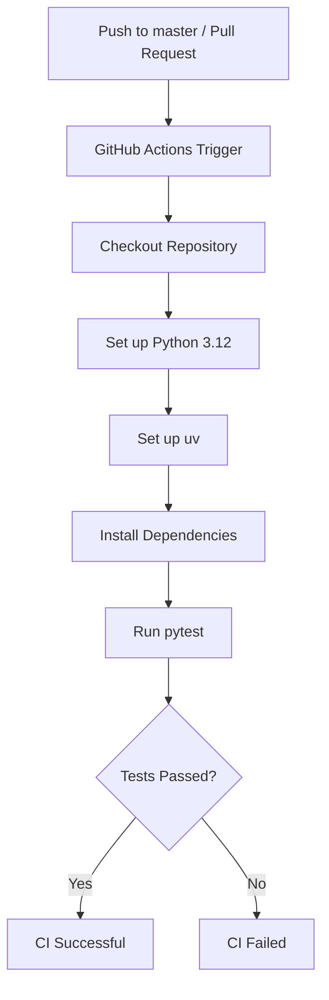

## 10. Continuous Integration (CI) with GitHub Actions

### Overview

Implemented a Continuous Integration (CI) pipeline using GitHub Actions to automatically install project dependencies and execute the automated test suite whenever code is pushed to the `master` branch or a pull request is created targeting `master`.

This ensures that changes to the project are validated through automated testing before being considered reliable.

### CI Workflow

The CI pipeline is configured using the workflow file:

`.github/workflows/ci.yml`

The workflow is triggered by:

- Push events to the `master` branch.
- Pull requests targeting the `master` branch.

### CI Pipeline Steps

1. **Checkout Repository** – Checks out the project repository onto the GitHub Actions runner.
2. **Set up Python** – Configures Python 3.12.
3. **Set up uv** – Installs the `uv` package manager.
4. **Install Dependencies** – Installs project dependencies using `uv sync --frozen`, ensuring dependency installation follows the committed lockfile.
5. **Run Automated Tests** – Executes the project test suite using pytest.

### CI Configuration

The pipeline runs on an Ubuntu GitHub-hosted runner.

The automated test command is:

```bash
uv run pytest tests/ -v
```

The workflow provides a CI-specific `OPENAI_API_KEY` environment variable to satisfy the application's configuration validation during test execution. The CI test environment uses a placeholder value rather than a real API key.

### CI Validation

The CI workflow was successfully executed and verified on GitHub Actions.

- **Platform:** GitHub Actions
- **Runner:** Ubuntu
- **Python Version:** 3.12
- **Dependency Manager:** uv
- **Testing Framework:** pytest
- **Status:** Successful

All workflow steps completed successfully, including dependency installation and automated test execution.

### CI Workflow



### Outcome

Automated testing is now integrated into the project development workflow through GitHub Actions. Every qualifying push or pull request triggers dependency installation and test execution, providing automated validation of the project's codebase.

Automated deployment through GitHub Actions was not implemented as part of this phase. The application was deployed and verified separately on Render.