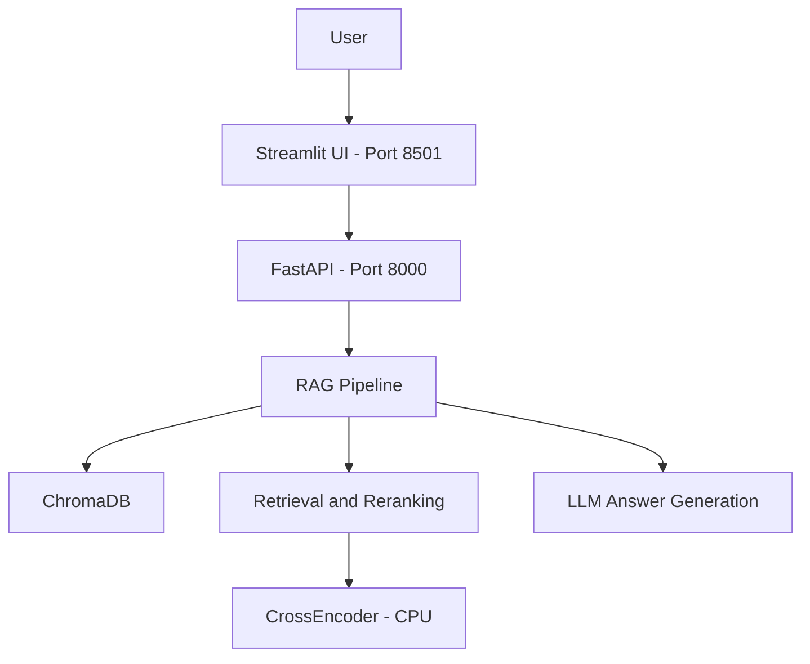

# Phase 9: Dockerization and Docker Image Optimization

## 1. Objective

The objective of Phase 9 was to containerize the Technical Documentation RAG application, orchestrate its API and UI services using Docker Compose, configure persistent storage and health checks, and optimize the Docker image size.

The application consists of:

- FastAPI backend
- Streamlit frontend
- ChromaDB vector store
- Sentence Transformers CrossEncoder reranker
- CPU-based inference

The phase also focused on investigating the Docker image size and removing unnecessary GPU-related dependencies from the Linux container environment.

---

## 2. Dockerization Architecture

The application was containerized using Docker and orchestrated through Docker Compose.

### Services

| Service | Technology | Port |
|---|---|---|
| API | FastAPI + Uvicorn | 8000 |
| UI | Streamlit | 8501 |
| Vector Store | ChromaDB | Persistent volume |

Both API and UI services use the same Docker image, while Docker Compose manages the service configuration and startup dependency.

### Architecture



---

## 3. Dockerfile Implementation

The application was containerized using the `python:3.12-slim` base image.

### Dockerfile

```dockerfile
# --------------------------------------------------
# 1. Base Python image
# --------------------------------------------------
FROM python:3.12-slim

# --------------------------------------------------
# 2. Set working directory
# --------------------------------------------------
WORKDIR /app

# --------------------------------------------------
# 3. Install uv
# --------------------------------------------------
RUN pip install --no-cache-dir uv

# --------------------------------------------------
# 4. Copy dependency files
# --------------------------------------------------
COPY pyproject.toml uv.lock ./

# --------------------------------------------------
# 5. Install project dependencies
# --------------------------------------------------
RUN uv sync --frozen --no-dev --no-install-project

# --------------------------------------------------
# 6. Copy application source code
# --------------------------------------------------
COPY src ./src

# --------------------------------------------------
# 7. Start FastAPI application
# --------------------------------------------------
CMD ["uv", "run", "--no-sync", "uvicorn", "src.api.main:app", "--host", "0.0.0.0", "--port", "8000"]
```

### Dockerfile Design Decisions

- **Python 3.12 Slim:** Used a lightweight Python base image.
- **uv:** Used for dependency management and installation.
- **Dependency caching:** Dependency files are copied before application source code to improve build caching.
- **Frozen lockfile:** `uv sync --frozen` ensures installation is based on the lockfile.
- **Production dependency installation:** `--no-dev` excludes development dependencies.
- **Application installation:** `--no-install-project` avoids installing the project itself as a package.
- **Source code:** Application source code is copied into the image.
- **API entrypoint:** FastAPI is served using Uvicorn.

---

## 4. Docker Compose Configuration

Docker Compose was used to orchestrate the API and UI services.

### docker-compose.yml

```yaml
services:

  api:
    build: .
    image: technical-doc-rag-eval:latest
    container_name: technical-doc-rag-api
    ports:
      - "8000:8000"
    env_file:
      - .env
    volumes:
      - ./chroma_db:/app/chroma_db
    healthcheck:
      test: ["CMD", "python", "-c", "import urllib.request; urllib.request.urlopen('http://localhost:8000/health')"]
      interval: 30s
      timeout: 10s
      retries: 3
      start_period: 20s

  ui:
    image: technical-doc-rag-eval:latest
    container_name: technical-doc-rag-ui
    ports:
      - "8501:8501"
    env_file:
      - .env
    environment:
      API_URL: http://api:8000/query
    depends_on:
      api:
        condition: service_healthy
    command: ["uv", "run", "--no-sync", "streamlit", "run", "src/ui/app.py", "--server.address=0.0.0.0", "--server.port=8501"]
```

### Key Configuration Details

#### API Service

- Builds the Docker image.
- Exposes port 8000.
- Loads environment variables from `.env`.
- Mounts ChromaDB storage.
- Includes a health check endpoint.

#### UI Service

- Uses the same Docker image.
- Exposes port 8501.
- Connects to the API using the Docker Compose service name `api`.
- Waits for the API to become healthy before starting.

#### Service Communication

The Streamlit UI communicates with the API using:

```text
http://api:8000/query
```

Docker Compose provides internal service discovery, allowing the UI container to communicate with the API container through the service name.

---

## 5. Persistent Storage

ChromaDB persistence was configured using a bind mount.

```yaml
volumes:
  - ./chroma_db:/app/chroma_db
```

### Purpose

- Persist vector database data outside the container.
- Retain database data when containers are recreated.
- Avoid losing the vector store when the application container is removed.

The host directory `./chroma_db` is mapped to `/app/chroma_db` inside the API container.

---

## 6. API Health Check

A health check was configured for the FastAPI service.

```yaml
healthcheck:
  test: ["CMD", "python", "-c", "import urllib.request; urllib.request.urlopen('http://localhost:8000/health')"]
  interval: 30s
  timeout: 10s
  retries: 3
  start_period: 20s
```

### Health Check Parameters

| Parameter | Value | Purpose |
|---|---|---|
| `interval` | 30 seconds | Health check frequency |
| `timeout` | 10 seconds | Maximum time for a health check |
| `retries` | 3 | Number of failed attempts before unhealthy status |
| `start_period` | 20 seconds | Initial grace period |

The UI service uses the API health status as a startup dependency.

---

## 7. Docker Image Optimization

### 7.1 Initial Image Analysis

The initial Docker image was approximately 10.16 GB in Docker Desktop.

The image was inspected using Docker image history and package analysis.

The dependency installation layer was identified as a major contributor to the image size.

The dependency tree revealed that:

- `sentence-transformers` depended on PyTorch.
- The Linux PyTorch installation included CUDA-related dependencies.
- CUDA and NVIDIA libraries contributed significantly to the image size.
- GPU inference was not required for this application.

The application was running CPU-based inference, so GPU-related dependencies were unnecessary for the Docker deployment.

### 7.2 Dependency Investigation

The dependency tree was investigated using:

```powershell
uv tree --invert --package torch
```

The dependency relationship was identified as:

```text
torch
└── sentence-transformers
    └── technical-doc-rag-eval
```

The Docker environment initially included packages such as:

- CUDA bindings
- CUDA toolkit
- NVIDIA CUDA libraries
- cuDNN
- NCCL
- Triton

These packages were associated with the CUDA-enabled PyTorch resolution.

### 7.3 CPU-Only PyTorch Verification

CPU-only PyTorch was installed and tested in a temporary container before changing the project dependency resolution.

The temporary test verified:

- CPU-only PyTorch installation
- CrossEncoder import
- CrossEncoder inference

The verified PyTorch version was:

```text
2.15.0+cpu
```

The CrossEncoder model used for reranking was:

```text
cross-encoder/ms-marco-MiniLM-L-6-v2
```

Inference was successfully executed using CPU-only PyTorch.

### 7.4 CPU-Only PyTorch Dependency Configuration

The following configuration was added to `pyproject.toml`:

```toml
[[tool.uv.index]]
name = "pytorch-cpu"
url = "https://download.pytorch.org/whl/cpu"
explicit = true

[tool.uv.sources]
torch = { index = "pytorch-cpu" }
```

PyTorch was also explicitly added to the project dependencies.

```toml
"torch",
```

This configuration directed PyTorch dependency resolution to the CPU-only package index.

### 7.5 Lockfile Regeneration

The lockfile was regenerated using:

```powershell
uv lock
```

The updated lockfile resolved CPU-only PyTorch and removed the Linux CUDA-related dependencies from the resolution.

Packages removed from the previous resolution included:

- `cuda-bindings`
- `cuda-pathfinder`
- `cuda-toolkit`
- NVIDIA CUDA libraries
- `nvidia-cudnn-cu13`
- `nvidia-nccl-cu13`
- `nvidia-nvshmem-cu13`
- `triton`

The lockfile was verified to include CPU-only PyTorch sourced from:

```text
https://download.pytorch.org/whl/cpu
```

The Linux/non-macOS resolution included:

```text
torch 2.15.0+cpu
```

---

## 8. Optimized Docker Image Build

The Docker image was rebuilt using the updated dependency configuration and lockfile.

### Build Command

```powershell
docker compose build api
```

The Docker build successfully completed using:

```dockerfile
RUN uv sync --frozen --no-dev --no-install-project
```

The optimized dependency resolution was used during image construction.

---

## 9. Docker Image Size Comparison

### Before Optimization

| Metric | Value |
|---|---:|
| Docker image disk usage | Approximately 10.16 GB |

### After Optimization

| Metric | Value |
|---|---:|
| Docker image disk usage | Approximately 2.69 GB |
| Docker image content size | 567 MB |

### Optimization Results

| Metric | Result |
|---|---:|
| Initial image | 10.16 GB |
| Optimized image | 2.69 GB |
| Space saved | Approximately 7.47 GB |
| Reduction | Approximately 73.5% |

The image size reduction was achieved primarily by eliminating the unnecessary CUDA-related dependency bundle from the Linux PyTorch resolution.

---

## 10. Docker Container Testing

The optimized image was tested by recreating the application containers.

### Recreate Containers

```powershell
docker compose up -d --force-recreate
```

### Verify Containers

```powershell
docker compose ps
```

The final verification confirmed:

| Service | Status |
|---|---|
| API | Up and Healthy |
| UI | Up and Running |

### API

- Container successfully started.
- Health check passed.
- API was accessible on port 8000.

### UI

- Streamlit container successfully started.
- UI was accessible on port 8501.

---

## 11. Application Validation

The application was tested through the Streamlit interface.

### UI URL

```text
http://localhost:8501
```

A RAG query was submitted through the chatbot.

The application successfully returned an answer.

The test confirmed that:

- The API was functioning.
- The Streamlit UI was functioning.
- The API and UI communicated successfully.
- The RAG pipeline remained functional.
- The CrossEncoder reranker worked with CPU-only PyTorch.
- The optimized Docker image did not break application functionality.

---

## 12. Docker Resource Cleanup

After validating the optimized image, obsolete images and temporary containers were removed.

### Temporary Container

The temporary container used for CPU-only PyTorch experimentation was removed.

```powershell
docker rm -f rag-cpu-test
```

### Obsolete Images

The previous Docker images were removed:

- `technical-doc-rag-api`
- `technical-doc-rag-eval-api`
- `technical-doc-rag-eval-ui`

The optimized image was preserved.

### Final Image Verification

```powershell
docker images
```

Final result:

```text
technical-doc-rag-eval:latest
```

The optimized image was the only remaining project image.

---

## 13. Final Docker Environment

| Component | Configuration |
|---|---|
| Base image | Python 3.12 Slim |
| Dependency manager | uv |
| Backend | FastAPI |
| API server | Uvicorn |
| Frontend | Streamlit |
| Vector database | ChromaDB |
| Reranker | CrossEncoder |
| PyTorch | CPU-only |
| API port | 8000 |
| UI port | 8501 |
| Docker orchestration | Docker Compose |
| Persistent storage | ChromaDB bind mount |
| Health check | FastAPI `/health` endpoint |

---

## 14. Commands Practiced

### Build

```powershell
docker compose build api
```

### Start Services

```powershell
docker compose up -d
```

### Recreate Services

```powershell
docker compose up -d --force-recreate
```

### Stop Services

```powershell
docker compose stop
```

### Start Stopped Services

```powershell
docker compose start
```

### Stop and Remove Compose Containers

```powershell
docker compose down
```

### View Running Containers

```powershell
docker ps
```

### View All Containers

```powershell
docker ps -a
```

### View Container Status

```powershell
docker compose ps
```

### View Logs

```powershell
docker compose logs
```

### View API Logs

```powershell
docker compose logs api
```

### View UI Logs

```powershell
docker compose logs ui
```

### Inspect Docker Images

```powershell
docker images
```

### Inspect Image Layers

```powershell
docker history technical-doc-rag-eval:latest
```

---

## 15. Key Learnings

During this phase, the following concepts were implemented and practiced:

- Docker containerization
- Docker image creation
- Dockerfile design
- Docker Compose orchestration
- Multi-service application deployment
- Container networking and service discovery
- Port mapping
- Environment variable management
- Persistent storage using bind mounts
- API health checks
- Dependency caching
- Production dependency installation
- Docker image layer analysis
- Dependency tree investigation
- CPU-only PyTorch deployment
- Docker image optimization
- Container lifecycle management
- Docker resource cleanup
- Application validation after optimization

---

## 16. Outcome

The Technical Documentation RAG application was successfully containerized and deployed using Docker Compose.

Both API and UI services were validated.

The Docker image was optimized by resolving PyTorch using the CPU-only package index, eliminating unnecessary GPU-related dependencies from the Linux dependency resolution.

The image disk usage was reduced from approximately 10.16 GB to 2.69 GB, representing an approximately 73.5% reduction.

The optimized application continued to function successfully, including the CrossEncoder reranking pipeline.

**Phase 9: Dockerization and Docker Image Optimization — Completed.**
